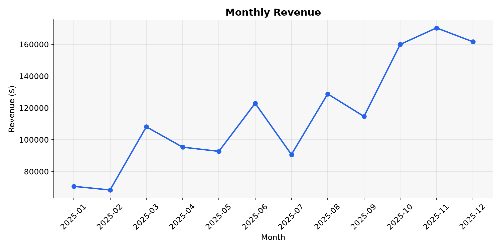
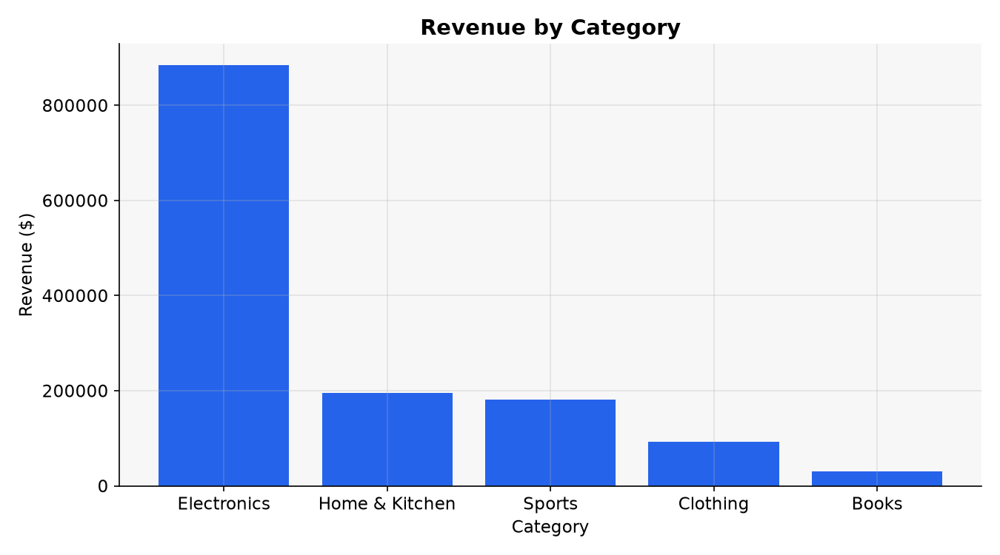
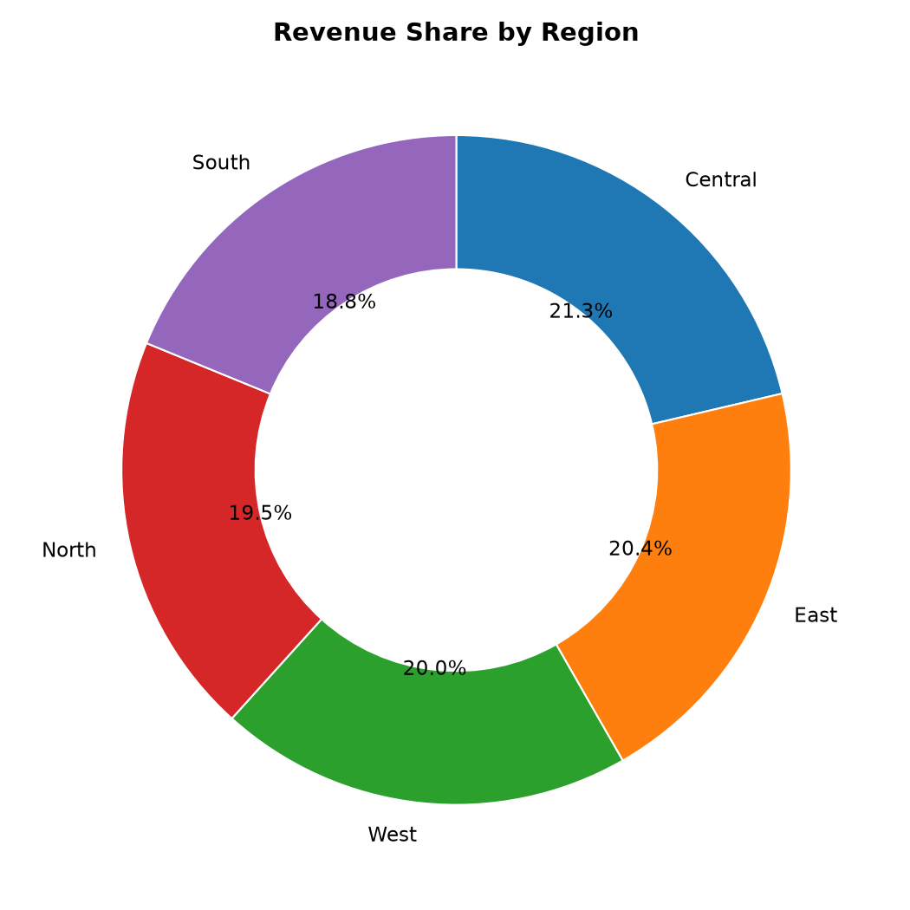
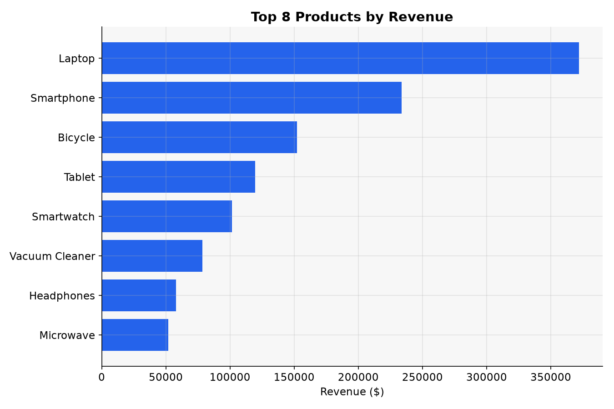

# Sales Insight

A small, dependency-light data-analysis tool that reads a sales CSV, computes
business metrics, and renders a set of clean charts plus a Markdown report.

Built as a learning/portfolio project to practice **pandas** for data
manipulation and **matplotlib** for visualization, with a clean module
structure, a command-line interface, and a unit-test suite.

## Features

- Loads and validates a sales CSV (clear errors for missing files/columns).
- Computes headline metrics: total revenue, orders, units, average order value.
- Aggregates revenue by **month**, **category**, **region**, and **top products**.
- Renders four publication-ready charts (PNG) and a Markdown summary report.
- Works headless (no display needed) thanks to matplotlib's `Agg` backend.
- Includes a reproducible sample-data generator and a `pytest` test suite.

## Sample output

| Monthly trend | Category breakdown |
| --- | --- |
|  |  |

| Region share | Top products |
| --- | --- |
|  |  |

## Project structure

```
sales-insight/
├── main.py                  # CLI entry point
├── generate_sample_data.py  # creates data/sales.csv (reproducible)
├── requirements.txt
├── pytest.ini
├── sales_insight/           # the library
│   ├── loader.py            # read + validate CSV, add revenue column
│   ├── analysis.py          # metrics and group-by aggregations
│   └── charts.py            # matplotlib chart rendering
├── data/
│   └── sales.csv            # sample dataset
├── output/                  # generated charts + report.md
└── tests/
    └── test_analysis.py     # unit tests
```

The code is split by responsibility (loading / analysis / visualization) so
each piece stays small, testable, and easy to extend.

## Getting started

Requires Python 3.10+.

```bash
# 1. install dependencies
python -m pip install -r requirements.txt

# 2. (optional) regenerate the sample dataset
python generate_sample_data.py

# 3. run the analysis
python main.py
```

Charts and `report.md` are written to `output/`.

### CLI options

```bash
python main.py -i data/sales.csv -o output --top 8
```

| Flag | Default | Meaning |
| --- | --- | --- |
| `-i`, `--input` | `data/sales.csv` | Path to the input CSV |
| `-o`, `--output` | `output` | Directory for charts and the report |
| `--top` | `8` | How many top products to chart |

## Using your own data

Provide a CSV with these columns:

```
order_id,date,product,category,region,quantity,unit_price
1,2025-01-15,Laptop,Electronics,North,2,1150.00
```

`date` is parsed as a timestamp; `revenue` is derived as `quantity * unit_price`.

## Running the tests

```bash
python -m pytest
```

The suite covers the summary metrics, each aggregation, and the loader's
error handling (missing file, missing columns, derived revenue).

## What I practiced

- Reading and cleaning tabular data with **pandas** (`groupby`, `resample`).
- Designing a small, well-separated package instead of one big script.
- Rendering consistent, styled charts with **matplotlib**.
- Writing a friendly **argparse** CLI and helpful validation errors.
- Unit testing with **pytest** fixtures and `tmp_path`.